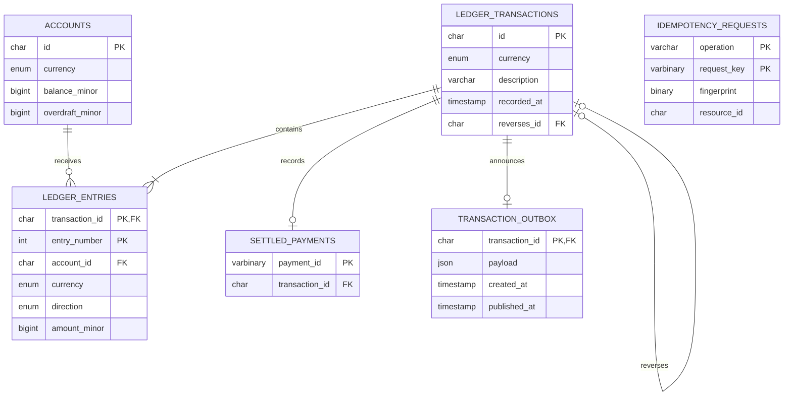

# MySQL schema and repository map

| Repository | Tables | Operations |
|---|---|---|
| `AccountRepository` | `accounts` | Insert at zero, read by ID, lock rows, update balances. |
| `IdempotencyRepository` | `idempotency_requests` | Claim and lock a key by operation, read fingerprint and result ID, complete claim. |
| `TransactionRepository` | `ledger_transactions`, `ledger_entries`, `settled_payments`, `transaction_outbox` | Read and insert immutable postings, check reversal links, record settled payment, enqueue announcement. |
| `OutboxRepository` | `transaction_outbox` | Lock the next pending event and mark it published after confirmation. |

Transaction and account IDs are UUIDs stored as strings. Composite entry foreign keys enforce that an entry has the same currency as both its transaction and its account. The idempotency result ID is a logical reference to an account or transaction according to the operation.

The database permits a transaction row to have no outbox row at the schema level. The posting service enforces at least two balanced entries and one outbox row within its database commit. See the [Flyway migration](../src/main/resources/db/migration/V1__ledger.sql).
