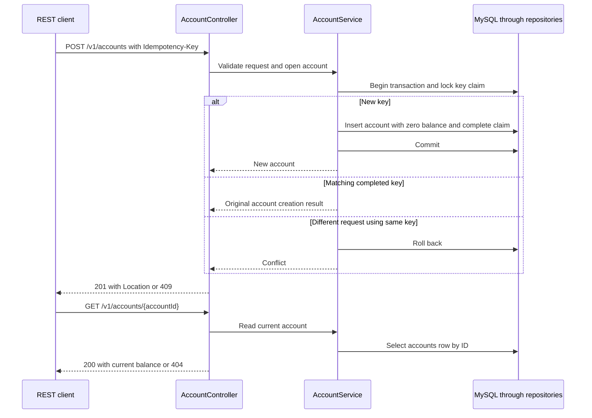
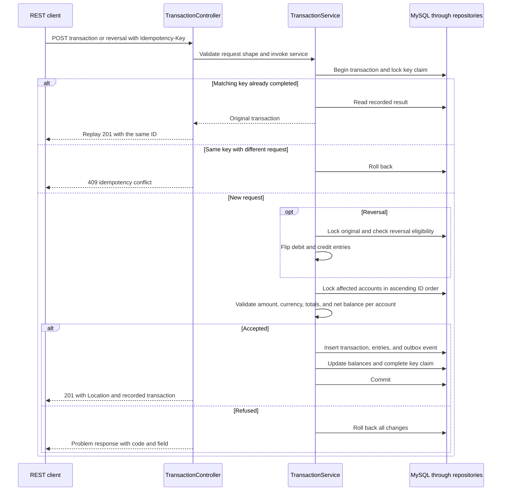
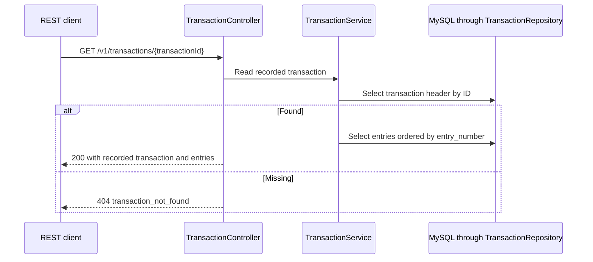

# REST endpoints and database access

| Endpoint | Service | Database access and result |
|---|---|---|
| `POST /v1/accounts` | `AccountService.open` | Claims a key in `idempotency_requests`, inserts an `accounts` row at zero balance, and stores the new ID in the claim. Returns 201 and Location. |
| `GET /v1/accounts/{accountId}` | `AccountService.get` | Reads `accounts` and formats the current balance for its currency. Returns 200 or 404. |
| `POST /v1/transactions` | `TransactionService.post` | Claims a key, locks accounts, inserts the transaction, entries, and outbox event, then updates balances and completes the key claim. Returns 201 and Location. |
| `GET /v1/transactions/{transactionId}` | `TransactionService.get` | Reads `ledger_transactions` and `ledger_entries` in entry order. Returns 200 or 404. |
| `POST /v1/transactions/{transactionId}/reversals` | `TransactionService.reverse` | Locks the original, checks eligibility, and posts flipped entries through the shared flow. Returns 201 and Location. |
| `GET /actuator/health` | Spring Boot Actuator | Reports service health and probes MySQL and RabbitMQ connectivity. |

All three REST writes require `Idempotency-Key`. A matching replay returns the original result. A different valid request using the same key for the same operation returns 409. See the [OpenAPI contract](../contracts/openapi.yaml).

## Account creation and read

## Posting and reversal

A reversal appends a new transaction linked by `reverses_id`. It preserves the original entries, observes overdraft limits, and cannot itself be reversed. A unique constraint prevents two reversals of the same transaction.

## Transaction read

