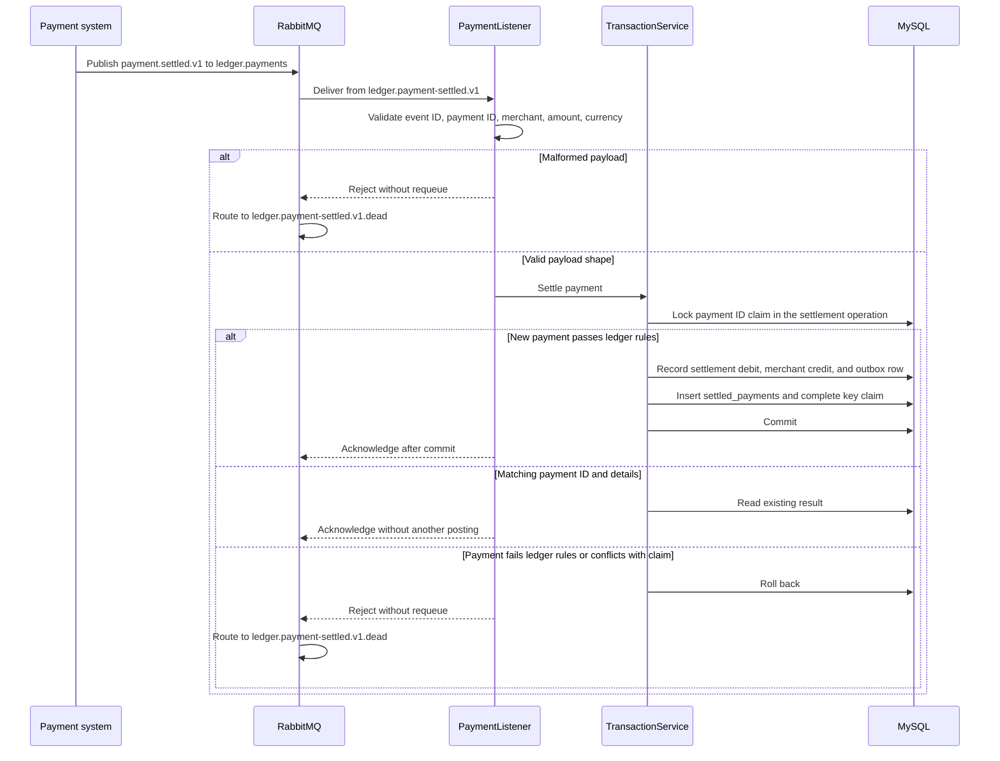
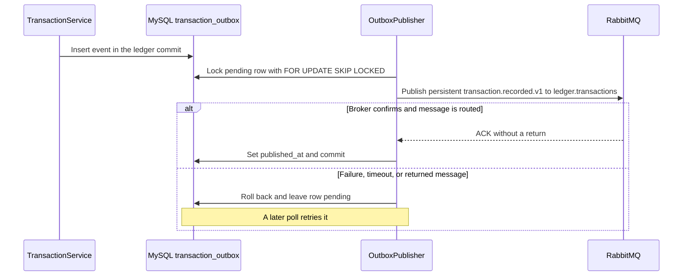

# RabbitMQ listener and outbox publisher

## Payment settlement listener

The payment ID identifies the ledger effect. Redelivery with a different event ID and the same payment details replays that effect. Unexpected processing failures are eligible for requeue.

## Transaction announcement publisher

The default durable queue is `ledger.transaction-recorded.v1`. Direct postings, reversals, and payments each create an announcement. A crash after broker confirmation and before updating MySQL can produce a duplicate. Deduplicate by `eventId`, which equals the transaction ID. Delivery has no global ordering guarantee. See the [event schemas](../contracts/events.yaml).
