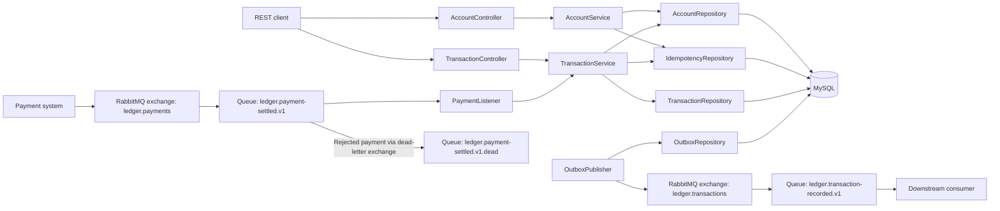

# Application overview

Controllers validate HTTP inputs. Services enforce ledger rules and own transaction boundaries. Repositories use Spring JDBC to access MySQL. `LedgerControllerAdvice` maps REST errors to problem responses with a status, code, and field. The listener maps invalid messages to broker rejections.
